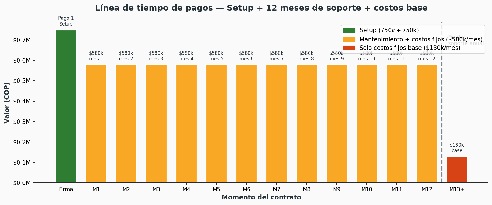
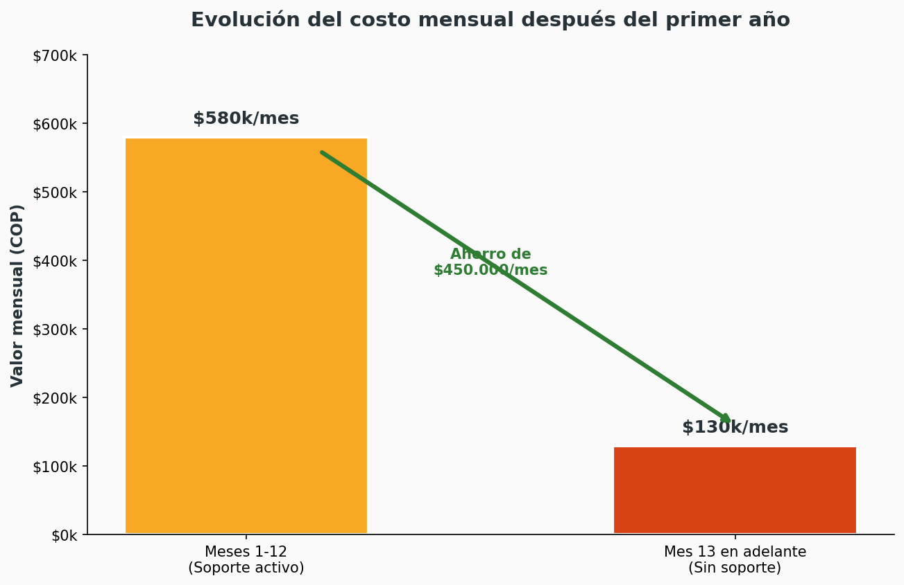
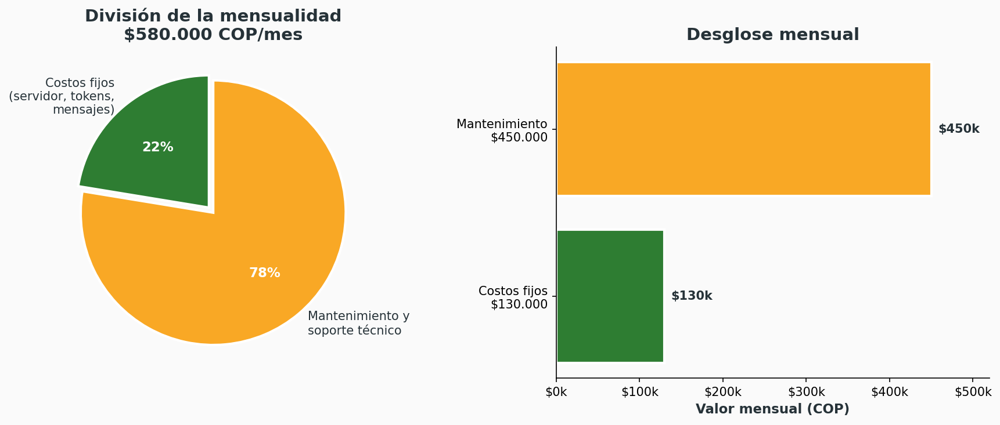
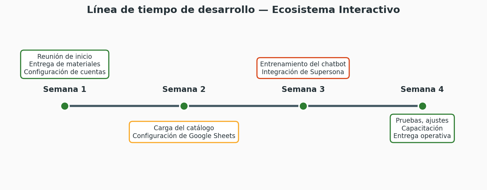
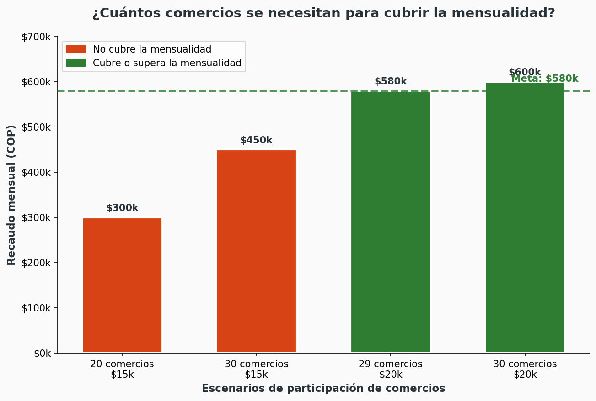
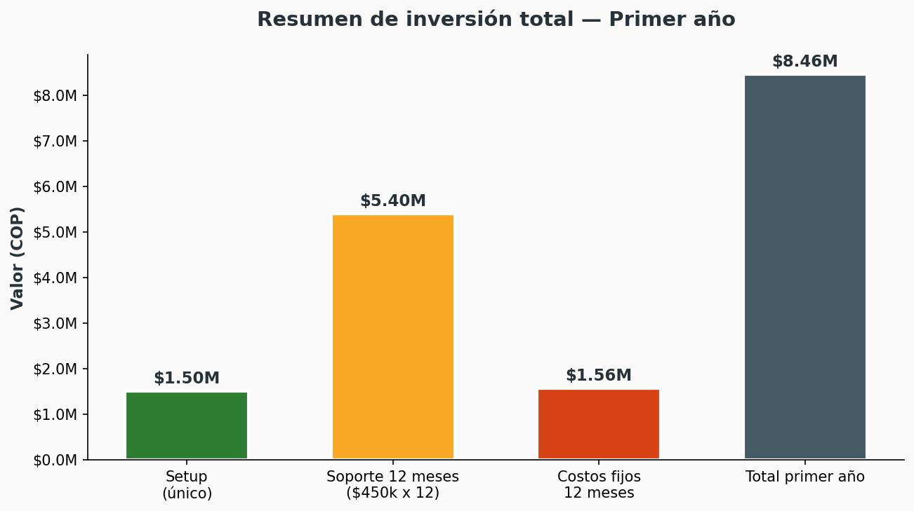

# BORRADOR — Oferta Ajustada: Ecosistema Interactivo
## Pueblito Boyacense · Concejo de Administración

**Cliente:** Administración Pueblito Boyacense — Sergio / Evelyn  
**Fecha:** [Fecha actual]  
**Preparado por:** Equipo de Desarrollo & Estrategia Digital  
**Versión:** Borrador de ajuste comercial v4

---

## 1. Propósito de este ajuste

Esta oferta nace de la solicitud de hacer la propuesta más accesible para el Pueblito Boyacense, sin perder el valor estratégico del proyecto original.

Hemos diseñado un **plan de arranque único** que concentra tres puntos de alto impacto: un catálogo interactivo de servicios para los comercios, atención automatizada 24/7 acompañada por **Supersona**, y conexión con redes sociales para captar tráfico.

> **Este no reemplaza el proyecto completo.** Es la forma más rápida de empezar a generar valor tangible para comerciantes y visitantes, dejando abierta la puerta al modelo de 4 pilares cuando la administración lo considere oportuno.

---

## 2. Supersona: el guía digital del Pueblito Boyacense

Integramos a **Supersona**, el héroe que defiende nuestras raíces, como el rostro y la voz del ecosistema digital del Pueblito Boyacense.

### 2.1 ¿Cómo participa Supersona?

Supersona es el embajador digital y guía cultural del Pueblito Boyacense. No es el chatbot, pero acompaña la experiencia del visitante en los puntos de contacto digitales.

- **Guía del catálogo digital:** da la bienvenida a los visitantes, explica cómo usar el catálogo y recomienda servicios según la manzana o el interés del turista.
- **Voz institucional:** aparece con un tono cercano, orgulloso y acogedor que representa las raíces boyacenses.
- **Conexión con los 7 pueblos:** Supersona puede contar historias cortas de Villa de Leyva, Tibasosa, Tenza, El Cocuy, Sáchica, Monguí y Ráquira mientras el visitante navega.
- **Elemento de fidelización:** mensajes de despedida, invitaciones a eventos como Bazarte, Semana Santa Cultural y Temporada Navideña.
- **Presencia en el chatbot:** el bot puede enviar mensajes de bienvenida o tips culturales con la imagen de Supersona, pero la atención automática y el soporte son funciones independientes del personaje.

### 2.2 Materiales necesarios para integrar a Supersona

- Imágenes oficiales del personaje en alta resolución.
- Guía de uso de la marca (colores, tipografías, frases permitidas).
- Historias o datos curiosos que Supersona pueda compartir con los visitantes.
- Aprobación de la administración para usar la imagen del personaje en el chatbot, el catálogo y las redes sociales.

> **Nota:** si no se cuenta con material gráfico suficiente, podemos trabajar con la fotografía del muñeco y la caja oficial para crear los avatares digitales.

---

## 3. Lista de verificación previa al contrato

Antes de firmar, debemos confirmar que el Pueblito Boyacense cuenta con lo siguiente:

### 3.1 Cuentas y accesos

| # | Requerimiento | ¿Quién lo provee? | Estado |
|---|---------------|-------------------|--------|
| 1 | Fanpage de Facebook activa del Pueblito Boyacense | Administración | ☐ |
| 2 | Cuenta de Instagram Business vinculada a Facebook | Administración | ☐ |
| 3 | Cuenta de WhatsApp Business del Pueblito | Administración | ☐ |
| 4 | Cuenta de YouTube oficial (para integración) | Administración | ☐ |
| 5 | Acceso administrativo a Meta Business Suite | Administración | ☐ |
| 6 | Dominio web activo (pueblitoboyacense.org) | Administración | ☐ |

### 3.2 Documentos institucionales

| # | Requerimiento | ¿Quién lo provee? | Estado |
|---|---------------|-------------------|--------|
| 7 | NIT o documento de identidad de la administración | Administración | ☐ |
| 8 | Correo institucional activo (@pueblitoboyacense.org o similar) | Administración | ☐ |
| 9 | Logo oficial, marca Supersona y autorizaciones de uso | Administración | ☐ |
| 10 | Autorización escrita de cada comercio para usar sus datos, fotos y videos | Comercios | ☐ |

### 3.3 Contenido de los comercios participantes

| # | Requerimiento | ¿Quién lo provee? | Estado |
|---|---------------|-------------------|--------|
| 11 | Listado de comercios que participarán en la primera fase | Administración | ☐ |
| 12 | Nombre, categoría y descripción de cada servicio | Comercios | ☐ |
| 13 | Precios actualizados de cada servicio o experiencia | Comercios | ☐ |
| 14 | Fotos de cada servicio (mínimo 2 por servicio) | Comercios | ☐ |
| 15 | Videos cortos de 15–30 segundos por servicio (deseable, no obligatorio) | Comercios | ☐ |
| 16 | Número de WhatsApp de cada comercio | Comercios | ☐ |
| 17 | Horarios de atención, ubicación dentro del complejo y datos de contacto | Comercios | ☐ |
| 18 | Preguntas frecuentes de cada comercio para entrenar la IA | Comercios | ☐ |

### 3.4 Responsables del proyecto

| # | Requerimiento | ¿Quién lo provee? | Estado |
|---|---------------|-------------------|--------|
| 19 | Gestor digital designado por el Pueblito (recibe capacitación) | Administración | ☐ |
| 20 | Persona de contacto para decisiones rápidas durante el desarrollo | Administración | ☐ |
| 21 | Persona encargada de aprobar textos, precios y contenido publicado | Administración | ☐ |

> **Nota:** Esta lista se debe completar antes del inicio del desarrollo. Lo que no se entregue a tiempo puede retrasar la entrega o dejar servicios fuera de la primera versión.

---

## 4. Plan recomendado: Ecosistema Interactivo

### 4.1 Inversión y condiciones comerciales

| Concepto | Valor | Detalle |
|----------|-------|---------|
| **Setup inicial (único)** | **$1.500.000 COP** | Configuración del catálogo de servicios, chatbot omnicanal, integración de Supersona como guía digital, capacitación, puesta en marcha y reuniones semanales de desarrollo. |
| **Mensualidad primeros 12 meses** | **$580.000 COP / mes** | Incluye $130.000 de costos fijos de operación + $450.000 de mantenimiento y soporte integral. |
| **A partir del mes 13** | **$130.000 COP / mes** | Solo costos fijos base de servidor, tokens, mensajes y plataforma. Sin soporte activo. |
| **Recontratación de soporte** | **A convenir** | Después de los 12 meses, pueden recontratar el servicio de mantenimiento y soporte si lo desean. |

**Forma de pago:**
- Setup: **$750.000 al firmar**, junto con la entrega de materiales; **$750.000 a la entrega operativa**.
- Mensualidad: $580.000 pagados al inicio de cada mes, durante los primeros 12 meses.
- A partir del mes 13: $130.000 pagados al inicio de cada mes.

**Condición importante:** la primera parte del setup ($750.000) se cancela junto con la entrega completa de los materiales y contenidos requeridos por parte del Pueblito y los comercios participantes. Sin materiales no se inicia el desarrollo.

**Contrato:** se firmará un contrato de servicios con duración inicial de 12 meses, renovable automáticamente al plan de costos base o con recontratación de soporte.

### 4.2 Desglose de la mensualidad ($580.000)

| Concepto | Valor | ¿Qué cubre? |
|----------|-------|-------------|
| **Costos fijos base** | **$130.000 COP / mes** | Servidor, dominio, consumo de tokens de IA, mensajería, licencias de plataforma y almacenamiento de contenido. Estos son gastos que van directamente a terceros. |
| **Mantenimiento y soporte** | **$450.000 COP / mes** | Soporte técnico, ajustes del bot, actualizaciones de la plataforma, capacitaciones, reportes mensuales, atención de caídas y seguridad. |
| **Total mensualidad** | **$580.000 COP / mes** | Valor total durante los primeros 12 meses. |

> El valor de $450.000 por mantenimiento y soporte es significativamente menor al costo de contratar una persona a medio tiempo para esta función, y garantiza respaldo técnico especializado.

---

## 5. Metodología de trabajo: reuniones semanales y control en Google Sheets

### 5.1 Reuniones semanales de desarrollo

Durante las primeras 4 a 6 semanas del proyecto se realizarán **reuniones semanales de avance** con el equipo del Pueblito.

- **Día y hora:** a convenir (recomendado: 1 hora por semana).
- **Objetivo:** revisar avances, resolver dudas, aprobar contenidos y ajustar prioridades.
- **Entregables por reunión:** reporte de avance, próximas tareas y decisiones pendientes.

### 5.2 Control del proyecto en Google Sheets

Toda la gestión del contenido, el avance y la configuración quedará en **Google Sheets**, para que todo el equipo del Pueblito pueda aprender a usarlo fácilmente.

Las hojas de cálculo incluirán:

- **Catálogo de servicios:** nombre, categoría, precio, descripción, comercio responsable, fotos, videos, estado de carga.
- **Eventos:** nombre, fecha, descripción, lugar, servicios relacionados, estado de publicación.
- **Ofertas:** servicio, descuento, vigencia, días y horarios aplicables, estado activo/inactivo.
- **Preguntas frecuentes:** preguntas y respuestas para entrenar al bot.
- **Conversaciones del bot:** frases, saludos, mensajes de transferencia a humano y límites de uso.
- **Calendario de contenido:** fechas de publicación, campañas y novedades.
- **Seguimiento de tareas:** quién hace qué, fechas límite y estado.
- **Reporte de métricas:** QR escaneados, conversaciones atendidas, servicios más vistos.

> **Beneficio:** al finalizar el proyecto, el Pueblito tendrá un sistema de control sencillo que cualquier persona del equipo puede administrar sin conocimientos técnicos avanzados.

---

## 6. Qué incluye exactamente

### 6.1 Catálogo digital de servicios tipo Reels / QR

Adaptamos la experiencia del menú digital Reels, pero en lugar de comidas mostramos **servicios y experiencias del Pueblito Boyacense**.

Cada servicio incluye:

- **Nombre y categoría:** hospedaje, restaurante, cafetería, artesanía, SPA, tour, evento, capilla, etc.
- **Descripción corta** del servicio o experiencia.
- **Precio actualizado** y opción de mostrar ofertas por día/horario.
- **Fotos y videos cortos** en carrusel tipo Reels.
- **Tags o etiquetas:** “Familiar”, “Romántico”, “Artesanal”, “Gastronomía”, “Bienestar”, etc.
- **Botón de WhatsApp directo** al comercio.
- **Botón de llamada** o “hablar con un asesor”.
- **Likes, comentarios y guardados** por parte de los visitantes.
- **Código QR personalizado** por comercio o por manzana.
- **Bienvenida de Supersona** al ingresar al catálogo.
- **Hosting** dentro de la web del Pueblito o en subdominio propio.

> **Materiales requeridos:** los comercios deben entregar fotos, videos cortos, descripciones, precios actualizados, logos, horarios y datos de contacto. No incluye sesión de fotografía ni producción de video. Si se requiere, se cotiza por separado con descuento para comerciantes del complejo.

### 6.2 Plataforma de administración para el Pueblito

Incluimos un panel de administración protegido con **usuario y contraseña**, para que el gestor digital del Pueblito pueda actualizar el contenido sin depender de nosotros.

Desde la plataforma se podrá gestionar:

- **Servicios:** crear, editar, activar o pausar servicios.
- **Videos:** subir, reemplazar o eliminar videos de cada servicio.
- **Fotos:** gestionar galería de imágenes por servicio.
- **Descripciones:** editar textos de presentación.
- **Precios:** cambiar precios y configurar ofertas por día o por horario.
- **Detalles:** incluye, no incluye, duración, capacidad, restricciones, etc.
- **Comentarios:** revisar, aprobar o eliminar comentarios de visitantes.
- **Likes y guardados:** ver métricas de interacción.
- **Categorías:** crear y ordenar categorías de servicios.
- **Tags:** asignar etiquetas para filtros y búsquedas.
- **WhatsApp de contacto:** actualizar número de cada comercio.
- **QR:** descargar códigos QR actualizados por servicio o por manzana.
- **Usuarios:** crear cuentas adicionales para comerciantes o administradores con permisos limitados.

La plataforma será accesible desde cualquier navegador. Incluye capacitación inicial para que el Pueblito pueda operar el servicio de forma autónoma.

### 6.3 Chatbot Omnicanal con IA (Meta)

Un solo asistente virtual con Inteligencia Artificial atenderá **WhatsApp, Instagram y Facebook** desde un solo punto.

- Respuestas automáticas 24/7 para consultas frecuentes sobre horarios, tarifas, eventos, ubicación de negocios, normas del complejo y servicios disponibles.
- Handover a atención humana cuando el bot no pueda resolver.
- Entrenamiento inicial con información de los comercios participantes.
- Panel de conversaciones y estadísticas básicas.
- Capacitación para los administradores del bot.
- **Supersona como acompañante:** el bot puede enviar mensajes de bienvenida, tips culturales o invitaciones a eventos con la imagen o el nombre de Supersona, pero el personaje no es el operador del chatbot.

#### Nota técnica sobre audios en WhatsApp

La API de WhatsApp Business **sí permite enviar y recibir mensajes de audio**. Esto significa que el bot puede responder con notas de voz pregrabadas o mensajes hablados generados por IA. Sin embargo, el envío de audios tiene consideraciones adicionales:

- Los audios deben cumplir con los formatos y tamaños aceptados por Meta (generalmente .ogg o .mp3).
- El consumo de tokens y el costo por mensaje pueden ser mayores que con texto.
- Para este plan, el bot responderá principalmente por texto. Los audios se pueden incluir como complemento en mensajes de bienvenida o tips de Supersona, previa configuración.
- Si en el futuro se requiere que el bot responda masivamente con audios, se debe evaluar el impacto en costos y se puede cotizar como servicio adicional.

#### Límite de uso de la IA

Para garantizar la sostenibilidad del servicio, establecemos un **límite diario de tokens/conversaciones** por usuario:

- **Límite:** 20 intercambios de mensajes por usuario al día.
- Cuando el usuario se acerca al límite, el bot envía un mensaje automático informando que la conversación será transferida.
- Si el bot detecta que no puede resolver la consulta, envía **hasta 3 mensajes automáticos** aclarando que está escribiendo a una persona.
- Al tercer mensaje, la conversación se transfiere automáticamente al WhatsApp de atención humana del Pueblito.

> Este límite protege el consumo de la IA y asegura que los casos complejos siempre lleguen a una persona.

### 6.4 Integración con redes sociales

- **YouTube:** automatización para responder comentarios en videos oficiales del Pueblito con llamados a la acción que redirijan al bot de WhatsApp o al catálogo de servicios.
- **Instagram y Facebook:** respuestas automáticas a comentarios y mensajes directos mediante el chatbot omnicanal.
- **TikTok:** por restricciones actuales de la plataforma, **no podemos incluir respuesta automática de comentarios en TikTok**. En su lugar, ofrecemos asesoría para que el equipo de contenido del Pueblito responda manualmente con plantillas optimizadas que redirijan al bot de WhatsApp.

> **Nota técnica:** La integración con YouTube depende de la disponibilidad de API y cuotas de la cuenta oficial. Si las cuotas son insuficientes, se propondrá una alternativa manual asistida o notificaciones al community manager.

---

## 7. Qué NO incluye este plan

Para mantener el setup accesible, esta oferta se concentra en conversión inmediata y atención automatizada. No incluye:

- Web estratégica nueva o rediseño completo del sitio.
- Mapa interactivo de las 7 manzanas.
- Directorio comercial avanzado con fichas completas.
- Control vehicular para hoteles.
- Sistema de eventos con inscripciones.
- Ecosistema QR de encuestas de satisfacción.
- Dashboard de KPIs avanzado.
- Verificación de Meta Business (se puede gestionar por aparte si se requiere).
- Producción de fotografía o video profesional.
- Respuesta automática en TikTok.
- Diseño de nueva imagen de Supersona (se trabaja con material existente).

Estos componentes están contemplados en el **Plan Completo + Verificación META** como escalamiento futuro.

---

## 8. Garantías, soporte y seguridad

### 8.1 Soporte incluido durante los primeros 12 meses

- Soporte técnico activo durante los primeros 12 meses.
- 30 días de ajustes gratuitos después de la entrega.
- Corrección de errores técnicos sin costo durante los primeros 60 días.
- Actualizaciones de la plataforma incluidas.
- Capacitación inicial y sesiones de refuerzo para el gestor digital.
- Reuniones semanales durante la fase de desarrollo.

### 8.2 Atención de caídas y seguridad

Nos comprometemos a atender cualquier caída del servidor, ataque informático o falla grave del sistema:

- **Tiempo de respuesta:** máximo 4 horas, incluidos sábados, domingos y días festivos.
- **Tiempo de restablecimiento:** menos de 24 horas en caso de fallas graves.
- **Cobertura:** 24/7 durante los 12 meses de soporte contratado.

### 8.3 Definición de error grave

Se considera **error grave** cualquier falla que haga que el sistema base sea imposible de usar para los clientes finales, incluyendo:

- El catálogo digital no carga o muestra error generalizado.
- El chatbot no responde en ninguno de los canales activos (WhatsApp, Instagram, Facebook).
- Los códigos QR no direccionan correctamente.
- Falla de seguridad que ponga en riesgo datos de comercios o visitantes.
- Caída completa del servidor o dominio.

Errores que **no se consideran graves**:

- Actualización de precios, fotos o textos (esto lo gestiona el Pueblito desde la plataforma o Google Sheets).
- Cambios menores en la interfaz.
- Agregar un nuevo servicio (se hace desde el panel de administración).
- Preguntas que el bot no responde correctamente (se resuelven ajustando el entrenamiento, dentro del soporte mensual).

### 8.4 Autosuficiencia del Pueblito

Durante los primeros meses dejaremos todo configurado, documentado y probado para que el Pueblito pueda resolver problemas graves de forma autónoma.

Esto incluye:

- Manual de emergencias con pasos para restablecer el servicio.
- Copias de seguridad automáticas y guía de restauración.
- Accesos administrativos a servidor, dominio y plataforma.
- Videos de capacitación para el gestor digital.
- Sesiones prácticas de simulación de fallas y recuperación.

> Si después de los 12 meses el Pueblito decide no recontratar el soporte, puede seguir usando el sistema pagando solo los costos fijos base ($130.000/mes), siempre que cuente con su propio gestor capacitado.

### 8.5 Beneficio adicional

- Si un nuevo comercio se suma dentro de los primeros 3 meses, se crea su ficha en el catálogo sin cobro de setup adicional (dentro del mismo pago mensual).

---

## 9. Recomendación de financiación con los comercios

Para que la mensualidad no recaiga solo sobre la administración, proponemos lo siguiente:

> **Cuota de participación mensual:** cada comercio que quiera aparecer en el catálogo digital y ser atendido por el chatbot aporta entre **$15.000 y $20.000 COP al mes**.

### Justificación para los comercios

> *“Este aporte se usa para entrenar al chatbot con los detalles de cada local: precios, horarios, servicios, ubicación y preguntas frecuentes. Mientras más aporte el comercio, mejor responderá el bot por él y más visibilidad tendrá en el catálogo digital del Pueblito. Además, su servicio podrá aparecer con tips y recomendaciones de Supersona.”*

### Ejemplo de cómo se reduce la carga

| Comercios participantes | Cuota mensual | Total recaudado | Cubre |
|-------------------------|---------------|-----------------|-------|
| 20 comercios | $15.000 | $300.000 | 52% de la mensualidad |
| 30 comercios | $15.000 | $450.000 | 78% de la mensualidad |
| 29 comercios | $20.000 | $580.000 | 100% de la mensualidad |
| 30 comercios | $20.000 | $600.000 | 100%+ de la mensualidad |

La administración puede decidir si cobra la cuota directamente o si incluye el beneficio en la administración mensual de cada local.

---

## 10. Tiempo de entrega

- **2 a 4 semanas** desde la firma y entrega de materiales.
- La fase de chatbot omnicanal depende de la aprobación y configuración de las cuentas de Meta del Pueblito.
- El catálogo digital se puede entregar en 2 semanas si los materiales llegan completos.

---

## 11. Argumento de negociación para presentar a Sergio

> *"Ajusté la propuesta integrando el catálogo de servicios, a Supersona como guía digital y toda la red de bots en un solo plan. Normalmente, desarrollar la IA para las redes sociales, personalizar un personaje institucional y montar el sistema de catálogo por separado superaría los $5.000.000 de entrada. Para ajustarnos a lo que pide Sergio y hacerlo más económico, unifiqué todo en una sola infraestructura y dejamos el costo de arranque en $1.500.000, pagos en dos cuotas."*

> *"Durante los primeros 12 meses pagarían $580.000 mensuales, de los cuales $130.000 son costos fijos de servidor, tokens y mensajes que van directamente a terceros, y $450.000 son por mantenimiento y soporte técnico. Eso es mucho menos de lo que costaría contratar a alguien a medio tiempo para esto, y además incluimos atención de caídas, seguridad y ataques en menos de 24 horas, incluso fines de semana."*

> *"Vamos a trabajar con reuniones semanales y todo el control del contenido quedará en Google Sheets, para que cualquier persona del equipo del Pueblito pueda aprender a administrarlo. Les entregamos el software y los capacitamos para que sean autosuficientes. Después de los 12 meses, si ya se sienten cómodos, solo pagan $130.000 mensuales por los costos base, o pueden recontratar el soporte si lo necesitan."*

> *"Además, la mensualidad se puede financiar con una cuota de $15.000 a $20.000 por comercio participante. Con 28 comercios a $20.000 se paga sola."*

---

## 12. Escalamiento futuro

Este plan deja la puerta abierta al modelo completo de transformación digital del Pueblito Boyacense:

| Etapa | Enfoque | Inversión referencial |
|-------|---------|----------------------|
| **Ecosistema Interactivo** | Catálogo de servicios + Supersona como guía digital + chatbot + YouTube/Instagram/Facebook | $1.500.000 setup + $580.000/mes durante 12 meses, luego $130.000/mes base |
| **Plan Completo + Verificación META** | 4 pilares completos: web, directorio, mapa, eventos, control vehicular, QR, dashboard, verificación Meta | $10.400.000 setup + $420.000/mes |

> El Ecosistema Interactivo puede migrarse al Plan Completo pagando la diferencia correspondiente. Lo invertido en el plan de arranque se considera dentro del valor total del proyecto.

---

## 13. Riesgos y problemáticas que podrían presentarse

### 13.1 Riesgos para el Pueblito Boyacense

| Riesgo | Probabilidad | Impacto | Cómo lo gestionamos |
|--------|--------------|---------|---------------------|
| Los comercios no entregan contenido a tiempo | Alta | Retraso en la entrega | Se define un piloto con 5 a 10 comercios motivados. Los que no entreguen quedan para una segunda fase. |
| El gestor digital capacitado sale del proyecto | Media | Pérdida de autonomía | Se entrega manual de usuario, videos de capacitación y Google Sheets como respaldo. Se ofrece una sesión de re-entrenamiento anual. |
| Los comercios no quieren pagar la cuota mensual | Media | La administración asume todo | Se comunica el valor desde el inicio. Quien no pague no aparece en el catálogo ni es atendido por el chatbot con prioridad. |
| Meta rechaza o retrasa la verificación | Media | El bot no funciona en WhatsApp API | Se revisan los documentos antes de firmar. Se incluyen 2 reaplicaciones gratuitas si el rechazo es por errores documentales. |
| YouTube limita las cuotas de API | Baja | La respuesta automática de comentarios falla | Se propone alternativa manual asistida con plantillas predefinidas. |
| Ataque informático o caída del servidor | Baja | Pérdida temporal del servicio | Se incluye respaldo diario, monitoreo y compromiso de restablecimiento en menos de 24 horas, 24/7. |
| El contenido se desactualiza después de entregar | Alta | Mala experiencia del visitante | Se capacita al gestor digital y se incluye un reporte mensual de contenido obsoleto durante los 12 meses de soporte. |
| Uso no autorizado de la imagen de Supersona | Baja | Problemas legales | Se exige autorización escrita de la administración antes de usar la marca. |

### 13.2 Riesgos para nosotros como proveedores

| Riesgo | Probabilidad | Impacto | Cómo lo gestionamos |
|--------|--------------|---------|---------------------|
| El Pueblito no entrega materiales junto con el primer pago | Media | Retrasos y reprocesos | No se inicia desarrollo hasta recibir el 80% de los requerimientos esenciales y el primer pago. |
| Consumo de IA supera lo estimado | Media | Pérdida de margen | Se establece el límite de 20 intercambios por usuario al día y se cobra por excedentes si se requiere más. |
| Soporte 24/7 genera costos operativos altos | Media | Margen reducido | El precio de $450.000/mes por soporte cubre atención de emergencias, no desarrollo de nuevas funciones. |
| El Pueblito no renueva soporte después de 12 meses | Alta | Ingresos recurrentes caen | Se entrega documentación completa y se deja claro que el plan base no incluye soporte. La recontratación se negocia por separado. |
| Cambios en políticas de Meta o WhatsApp | Baja | El bot deja de funcionar como se diseñó | Se mantiene actualizado con los cambios de API durante el periodo de soporte. |
| Demandas por uso no autorizado de imágenes de comercios | Baja | Problemas legales | Se exige autorización escrita de cada comercio antes de publicar su contenido. |

---

## 14. Próximos pasos

1. Completar la lista de verificación previa al contrato.
2. Confirmar cuántos comercios participarán en la primera fase.
3. Validar cuentas oficiales de Meta, YouTube, Instagram y Facebook del Pueblito.
4. Entregar checklist de materiales: logos, fotos de Supersona, videos, precios, datos de comercios, contactos institucionales.
5. Definir si se aplicará la cuota de participación a los comercios.
6. Revisar y firmar contrato de 12 meses.
7. Cancelar primer pago del setup ($750.000) junto con la entrega de materiales.
8. Agendar reunión semanal de inicio de desarrollo.
9. Iniciar desarrollo.

---

## 15. Anexo visual: gráficas generadas

Todas las gráficas de esta propuesta fueron generadas con código y están disponibles en la carpeta `Pueblito Boyacense/graficas/`. Se pueden usar directamente en la versión final de la propuesta o como base para un diseño más elaborado.

Las gráficas generadas son:

### 15.1 Línea de tiempo de desarrollo

**Ubicación:** sección 5.1 (Reuniones semanales de desarrollo).

**Archivo:** `graficas/01_linea_tiempo_desarrollo.png`

### 15.2 Línea de tiempo de pagos

**Ubicación:** sección 4.1 (Inversión y condiciones comerciales).

**Archivo:** `graficas/02_linea_tiempo_pagos.png`

### 15.3 División de la mensualidad: costos fijos vs. mantenimiento

**Ubicación:** sección 4.2 (Desglose de la mensualidad).

**Archivo:** `graficas/03_division_mensual.png`

### 15.4 Evolución del costo mensual

**Ubicación:** sección 4.1 (Inversión y condiciones comerciales).

**Archivo:** `graficas/04_evolucion_costos.png`

### 15.5 Flujo del chatbot: ¿cuándo se transfiere a una persona?

**Ubicación:** sección 6.3 (Límite de uso de la IA).

**Estado:** pendiente de diseño. Esta gráfica requiere un diagrama de flujo con íconos de robot, mensajes y persona. Se puede crear con herramientas de diseño como Figma, Canva o Gemini.

**Prompt sugerido para Gemini/Canva:**
> "Diagrama de flujo vertical minimalista para un chatbot de WhatsApp. Inicio: usuario envía mensaje. Proceso: bot responde con IA. Decisión: ¿resolvió la consulta? Si sí, fin. Si no, 3 mensajes automáticos de escalamiento. Final: transferencia a persona real por WhatsApp. Colores verde bosque, amarillo dorado y gris. Estilo plano, profesional, fondo blanco. Incluir íconos de robot, burbujas de chat y persona."

### 15.6 Error grave vs. no grave

**Ubicación:** sección 8.3 (Definición de error grave).

**Estado:** pendiente de diseño. Se sugiere una infografía con dos columnas: alerta roja para errores graves y check verde para situaciones de gestión normal.

**Prompt sugerido para Gemini/Canva:**
> "Infografía dividida en dos columnas para una propuesta comercial. Columna izquierda: 'Error grave' con fondo rojo suave, iconos de alerta y ejemplos: catálogo caído, bot no responde, QR fallan, falla de seguridad. Columna derecha: 'No es error grave' con fondo verde suave, iconos de check y ejemplos: cambiar precios, subir fotos, agregar servicio, entrenar al bot. Estilo plano, profesional, tipografía legible, fondo blanco."

### 15.7 Mapa de presencia de Supersona

**Ubicación:** sección 2 (Supersona: el guía digital).

**Estado:** pendiente de diseño. Se sugiere una infografía con Supersona en el centro y líneas a los canales donde participa.

**Prompt sugerido para Gemini/Canva:**
> "Infografía con un muñeco de peluche campesino boyacense (sombrero, ruana, botas) en el centro como guía digital. Líneas que conectan el personaje con: catálogo digital de servicios, bienvenida del chatbot, tips culturales de los 7 pueblos, redes sociales. En un lateral, una caja de texto que diga: 'Supersona NO es el chatbot: la atención automática y el soporte técnico son funciones independientes'. Estilo ilustrado, cálido, colores tierra, verde y amarillo. Fondo blanco."

### 15.8 Cuota de comercios: ¿cómo se financia la mensualidad?

**Ubicación:** sección 9 (Recomendación de financiación).

**Archivo:** `graficas/05_cuota_comercios.png`

### 15.9 Resumen de inversión total — Primer año

**Ubicación:** sección 4.1 o como resumen ejecutivo.

**Archivo:** `graficas/06_resumen_inversion.png`

---

**Nota interna:** este documento es un borrador. Antes de enviarlo al cliente se debe revisar precios finales, términos legales, viabilidad técnica de las integraciones sociales, confirmar el límite de tokens diarios con el proveedor de IA, ajustar el SLA de soporte según capacidad operativa real, verificar permisos de uso de la marca Supersona y diseñar las gráficas sugeridas en este anexo.
